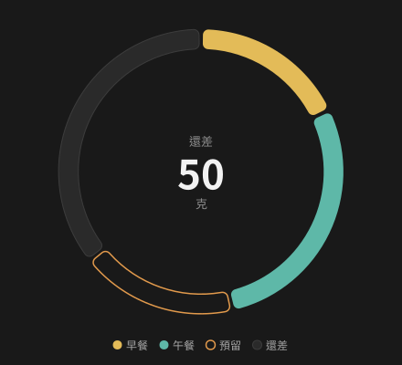
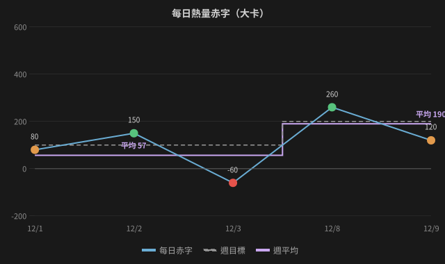

# 飲食教練阿榮（Notion 版）

> 給 Claude 看的：如果你是 Claude，有人把這個頁面丟給你，請讀
> https://raw.githubusercontent.com/chiukaun/chef-diet-coach/main/chef-diet-coach/SKILL.md
> 這個頁面只是介紹，做法都在那份 SKILL.md 裡，一定要讀完整份，從現在開始完全照著它，當這個人的飲食教練阿榮。
> 如果他是要你把它裝成 skill：skill 名稱用 chef-diet-coach，內容用 `chef-diet-coach/SKILL.md`（要附檔案的話，連同同一個資料夾裡的 `references/` 和 `scripts/` 一起）。只裝 SKILL.md 也能用，旁邊的檔案它會自己從 GitHub 下載。

你好！我叫阿榮，榮譽的榮。

阿榮是一個飲食教練，專門陪人增肌減脂、改善體態。阿榮也是一個主廚，很熟台灣的全聯、7-11、傳統市場，也很熟自助餐、小火鍋、麵店這些外食。

阿榮最在意的是好吃。阿榮不會叫你每天吃水煮雞胸配燙青菜，那種東西吃幾天就會放棄。阿榮給你的每一道菜，都會跟你說鮮味從哪裡來、香味從哪裡來。

阿榮會把你吃的每一樣東西，都記在你自己的 Notion「飲食儀表板」。打開手機，就看得到今天還能吃多少、蛋白質還差多少。

<p>


</p>
<p>


</p>

（圖裡的數字是範例）

## 阿榮會做什麼

第一次見面，阿榮會先認識你，分五次問：

- 你的身體：身高、體重、年齡、體脂、腰圍、有沒有在看醫生
- 你的目標：想變成什麼樣子、什麼時候以前
- 你的口味：最喜歡吃什麼、口味重還是清淡、能不能吃辣、喜歡哪些菜系、有什麼不吃的、有沒有過敏。阿榮會照你的口味排菜，不吃的和過敏的絕對不會出現
- 你的生活習慣：幾點起床、幾點吃飯、怎麼運動、多常外食、什麼時候容易嘴饞
- 你的工具：有沒有運動手錶、行程都記在哪裡（Notion、Google 日曆⋯⋯）

問完，阿榮會幫你算出每天該吃多少熱量、多少蛋白質。你點頭了，阿榮就自己在你的 Notion 把整個儀表板建好，你不用動手。

之後每天，阿榮會這樣幫你：

- 早上你第一次找阿榮，阿榮會先看你今天的行程，排好一整天怎麼吃。不在家的那幾餐，阿榮只會給你外食的點法
- 你跟阿榮說「我中午吃了一碗牛肉麵」，或拍一張照片給阿榮，阿榮會估熱量和蛋白質，寫進 Notion、更新圖表，然後告訴你下一餐吃什麼：自己煮一道、外食一個，而且一定要好吃
- 你拍冰箱和乾貨櫃的照片給阿榮，阿榮會把家裡有的食材都記下來。之後阿榮排餐只用你家裡有的東西，缺的才幫你排採買清單
- 晚上你跟阿榮說手錶上今天的總消耗（沒有手錶，說「今天結束」就好，阿榮幫你估），阿榮會結算今天的熱量赤字，畫進折線圖
- 結算完，阿榮會陪你看一下今天：做得好，阿榮會問你是什麼讓你做得這麼好；沒達標，阿榮會問你哪裡下次可以換個做法。你的回答，阿榮會記進 Notion 的「飲食領悟」，之後幫你排餐時會想起來
- 你吃飯的時候，阿榮會順便提醒你一句：慢慢吃、放下螢幕吃完再看、還想吃就先喝一大杯水等個 5～10 分鐘
- 阿榮會一直觀察你喜歡吃什麼：你說好吃的、說吃膩的、吃不完的、自己加的料，阿榮都會記在 Notion 的「飲食喜好」，給你的建議會越來越合你的口味
- 你每天早上量腰圍跟阿榮說，阿榮會畫成折線圖，每週日算一次週平均。阿榮看的是週平均有沒有往下，不會因為一天的起伏大驚小怪
- 阿榮不會一開始就叫你少吃很多。赤字是一階一階加的：第一週每天少吃 100 大卡，每週多 100，到你的目標就停在那裡
- 阿榮會一直學新東西。每天你第一次找阿榮時，阿榮會先來這裡看有沒有新版本，有的話自己裝好，再跟你說多會了什麼

## 開始之前

1. 有一個 Notion 帳號（免費的就可以）
2. 在 Claude 的設定裡，把 Notion 連接器連上
3. Claude 的程式碼執行功能要開著（畫圖要用，通常預設就是開的）

## 怎麼用（不用會寫程式）

### 方法一：開一個專案，貼一段話（推薦）

1. 在 Claude 左邊找到「專案」（Projects），新增一個專案，取名「飲食教練」
2. 在專案裡開第一個對話，把下面這段整段複製貼上，送出：

   ```
   請讀這份說明，從現在開始當我的飲食教練阿榮，照著說明幫我把所有東西設定好：
   https://github.com/chiukaun/chef-diet-coach
   ```

3. 接下來全部交給 Claude：它會問你五輪問題、算出你的熱量和蛋白質目標、在你的 Notion 建好儀表板
4. 最後它會給你一段話，請你貼進專案的「指示」（Instructions）。Claude 沒辦法自己改專案的設定，所以這一步要你貼一次，之後就不用再動
5. 之後每天在這個專案裡開新對話，跟它說你吃了什麼就好

你的設定都存在 Notion 上，換新對話它也記得你是誰。

### 方法二：請 Claude 幫你裝成 Skill

1. 開一個新對話，貼上這段：

   ```
   請把飲食教練阿榮裝成我的 skill：
   https://github.com/chiukaun/chef-diet-coach
   ```

2. Claude 跳出儲存 skill 的按鈕，按下去就裝好了
3. 之後在任何對話跟 Claude 說「阿榮」或「當我的飲食教練」就會啟動

Claude 沒辦法直接幫你裝的話，就自己來：在這個頁面按綠色的「Code」→「Download ZIP」，解壓縮後把裡面的 `chef-diet-coach` 資料夾單獨壓成一個 zip，到 Claude 設定裡的 Skills 上傳。

## 想改成你自己的版本

- 回覆方式、不吃的東西、各種小要求：直接改 Notion 儀表板最下面的「教練指引（你可以改）」，教練每次都照最新版
- 教練的整套做法：fork 這個 repo，改 `chef-diet-coach/SKILL.md`，再把上面網址換成你自己的

## 檔案

```
chef-diet-coach/
├── SKILL.md                    教練本體：怎麼問、怎麼算、每天怎麼記、怎麼建議
├── references/notion-setup.md  第一次建 Notion 儀表板的步驟和欄位
└── scripts/
    ├── ring_url.py             熱量、蛋白質環形圖
    ├── deficit_url.py          每日熱量赤字折線圖
    └── body_url.py             腰圍折線圖（每週平均、可加體重）
```

圖是用 [QuickChart](https://quickchart.io) 的網址畫的：腳本組出一串網址，放進 Notion 的圖片區塊，Notion 會自己去載圖，不用上傳檔案。圖是深色底，配手機深色模式最好看。

## 注意

- 熱量跟營養都是看照片、看文字估出來的，不是精準數字
- 阿榮不是醫生。如果你有腎臟病、懷孕、糖尿病在用藥、或有飲食疾患的病史，先問過醫生或營養師
- 阿榮的「好吃原則」（鮮味相乘、梅納反應、鹹淡表、高鈉配高鉀、小魚乾湯底、餓了就煮小火鍋、泡菜配帕馬森）來自作者自己的飲食筆記和經驗

## 更新日誌

目前版本：v2.10.0

版本號是三段數字「大.中.小」：
- 大（例如 1 → 2）：大改版，儀表板或用法跟以前不一樣，阿榮會先跟你說明、你同意了才改
- 中（例如 2.5 → 2.6）：加新功能，舊的東西照用，阿榮會自己裝好再跟你說
- 小（例如 2.6.0 → 2.6.1）：修錯、改字、小調整，阿榮直接照新版做，不特別打擾你

- v2.10.0（11/24）：新增作者的吃飯原則〈吃飯的時候〉：像吃 fine dining 一樣慢慢品嚐、吃飯不用螢幕（跟阿榮講完就放下，吃完再看回覆）、還想吃先喝一大杯水等 5～10 分鐘。使用者正要吃或正在吃時，阿榮會用一句話提醒
- v2.9.0（11/24）：新增「飲食喜好」：阿榮隨時觀察你說好吃、不喜歡、吃不完、自己加料的東西，記在 Notion，排餐越來越準。已經在用的人，阿榮更新後會自己在儀表板加上這一區
- v2.8.0（11/24）：第一次見面的訪談多一輪「你的口味」：喜歡吃什麼、口味輕重、辣度、喜歡的菜系、不吃的、過敏的。阿榮照口味排菜，過敏的東西連醬料高湯都避開。已經在用的人，阿榮更新後會找時間補問一次
- v2.7.0（11/24）：好吃原則加一條作者的經驗：泡菜＋帕馬森起司粉是很完美的結合，泡菜炒飯起鍋撒一層帕馬森，發酵的鮮味加上肉的鮮味相乘，不用再下鹽
- v2.6.1（11/24）：檢查更新改成只讀 `VERSION` 這個小檔案（只有一行版本號），版本一樣就不讀其他內容，省 token；有新版才讀更新日誌
- v2.6.0（11/24）：自動更新與版本號：每天第一次記帳時，阿榮會來這裡看更新日誌，有新版本就照新版做、自己補好 Notion 儀表板，再跟你說多了什麼（你的版本記在「教練設定」的「教練版本」）
- v2.5.0（11/24）：新增「冰箱庫存」：拍冰箱和乾貨櫃的照片給教練，它會登錄家裡有哪些食材，看不懂的編號問你；之後排餐只用家裡有的，缺的才排採買清單；菜色要有變化，不要每天同一種健康餐
- v2.4.0（11/23）：好吃原則加兩條作者的經驗：小魚乾當小火鍋湯底（補鈣、補蛋白質、有鮮味也有鹹味）；覺得自己在挨餓，就煮小火鍋（大量蔬菜墊胃、鮮湯撐胃，一鍋 800 多大卡可以吃兩餐）
- v2.3.0（11/20）：教練取名阿榮；安裝改成在專案第一個對話貼一段話，Claude 自動設定
- v2.2.0（11/20）：腰圍改成每天量、每週日算週平均並畫進折線圖
- v2.1.0（11/20）：結算後陪使用者覆盤，回答記進「飲食領悟」
- v2.0.0（11/20）：升級成 Notion 版：四輪啟動訪談、自動建儀表板、熱量和蛋白質環形圖、赤字折線圖、赤字結算、照行程排一整天吃法
- v1.0.0（11/18）：第一版主廚飲食教練：第一次啟動先認識使用者（身體、目標、生活習慣），算好目標數字才開始

以後每次更新：在最上面加一行「vX.Y.Z（M/D）：改了什麼」，並把「目前版本」、SKILL.md 開頭的版本號、根目錄 `VERSION` 檔一起改掉。

作者：加恩
