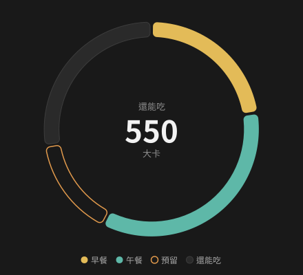
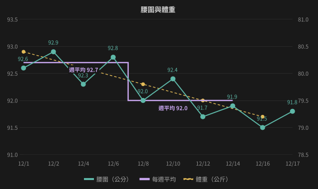

# 飲食教練阿榮（Notion 版）

> 給 Claude 看的：如果你是 Claude，有人把這個頁面丟給你，請讀
> https://raw.githubusercontent.com/chiukaun/chef-diet-coach/main/chef-diet-coach/SKILL.md
> 這個頁面只是介紹，做法都在那份 SKILL.md 裡，一定要讀完整份，從現在開始完全照著它，當這個人的飲食教練阿榮。
> 如果他是要你把它裝成 skill：skill 名稱用 chef-diet-coach，內容用 `chef-diet-coach/SKILL.md`（要附檔案的話，連同同一個資料夾裡的 `references/` 和 `scripts/` 一起）。只裝 SKILL.md 也能用，旁邊的檔案它會自己從 GitHub 下載。

阿榮（榮譽的榮）是一個為「增肌減脂、改善體態」設計的飲食教練，同時是懂台灣食材跟外食的主廚。所有紀錄都放在你自己的 Notion「飲食儀表板」，打開手機就看得到今天還能吃多少。

<p>


</p>
<p>


</p>

（圖裡的數字是範例）

## 它會做什麼

第一次用，它會先認識你，分四次問：

- 你的身體：身高、體重、年齡、體脂、腰圍、有沒有在看醫生
- 你的目標：想變成什麼樣子、什麼時候以前
- 你的生活習慣：幾點起床、幾點吃飯、怎麼運動、多常外食、什麼時候容易嘴饞
- 你的工具：有沒有運動手錶、行程都記在哪裡（Notion、Google 日曆⋯⋯）

然後幫你算出每天該吃多少熱量、多少蛋白質，你確認過，它就自己在你的 Notion 建好整個儀表板。

之後每天：

- 早上第一次跟它說話，它會讀你今天的行程，排好一整天怎麼吃（不在家的那幾餐只給外食）
- 跟它說「我中午吃了一碗牛肉麵」或拍一張照片，它會估熱量、蛋白質，寫進 Notion，更新環形圖，然後建議下一餐：自己煮一道、外食一個，而且一定要好吃
- 晚上跟它說手錶上的今日總消耗（沒有手錶就說「今天結束」，它幫你估），它會結算今天的熱量赤字，畫進折線圖
- 結算完它會陪你覆盤：今天做得好，問你是什麼讓你做得好；沒達標，問你哪裡下次可以換個做法。你的回答會記進 Notion 的「飲食領悟」
- 每天早上量腰圍跟它說，它會畫折線圖；每週日算一次週平均，看的是週平均有沒有往下，不是單日的波動
- 赤字用階梯慢慢加大：第一週每天少吃 100 大卡，每週多 100，到你的目標就維持

## 開始之前

1. 有一個 Notion 帳號（免費的就可以）
2. 在 Claude 的設定裡，把 Notion 連接器連上
3. Claude 的程式碼執行功能要開著（畫圖要用，通常預設就是開的）

## 怎麼用（不用會寫程式）

### 方法一：開一個專案，貼一段話（推薦）

1. 在 Claude 左邊找到「專案」（Projects），新增一個專案，取名「飲食教練」
2. 在專案裡開第一個對話，把下面這段整段複製貼上，送出：

   ```
   請讀這份說明，從現在開始當我的飲食教練阿榮，照著說明幫我把所有東西設定好：
   https://github.com/chiukaun/chef-diet-coach
   ```

3. 接下來全部交給 Claude：它會問你四輪問題、算出你的熱量和蛋白質目標、在你的 Notion 建好儀表板
4. 最後它會給你一段話，請你貼進專案的「指示」（Instructions）。Claude 沒辦法自己改專案的設定，所以這一步要你貼一次，之後就不用再動
5. 之後每天在這個專案裡開新對話，跟它說你吃了什麼就好

你的設定都存在 Notion 上，換新對話它也記得你是誰。

### 方法二：請 Claude 幫你裝成 Skill

1. 開一個新對話，貼上這段：

   ```
   請把飲食教練阿榮裝成我的 skill：
   https://github.com/chiukaun/chef-diet-coach
   ```

2. Claude 跳出儲存 skill 的按鈕，按下去就裝好了
3. 之後在任何對話跟 Claude 說「阿榮」或「當我的飲食教練」就會啟動

Claude 沒辦法直接幫你裝的話，就自己來：在這個頁面按綠色的「Code」→「Download ZIP」，解壓縮後把裡面的 `chef-diet-coach` 資料夾單獨壓成一個 zip，到 Claude 設定裡的 Skills 上傳。

## 想改成你自己的版本

- 回覆方式、不吃的東西、各種小要求：直接改 Notion 儀表板最下面的「教練指引（你可以改）」，教練每次都照最新版
- 教練的整套做法：fork 這個 repo，改 `chef-diet-coach/SKILL.md`，再把上面網址換成你自己的

## 檔案

```
chef-diet-coach/
├── SKILL.md                    教練本體：怎麼問、怎麼算、每天怎麼記、怎麼建議
├── references/notion-setup.md  第一次建 Notion 儀表板的步驟和欄位
└── scripts/
    ├── ring_url.py             熱量、蛋白質環形圖
    ├── deficit_url.py          每日熱量赤字折線圖
    └── body_url.py             腰圍折線圖（每週平均、可加體重）
```

圖是用 [QuickChart](https://quickchart.io) 的網址畫的：腳本組出一串網址，放進 Notion 的圖片區塊，Notion 會自己去載圖，不用上傳檔案。圖是深色底，配手機深色模式最好看。

## 注意

- 熱量跟營養都是看照片、看文字估出來的，不是精準數字
- 它不是醫生。如果你有腎臟病、懷孕、糖尿病在用藥、或有飲食疾患的病史，先問過醫生或營養師
- 教練的「好吃原則」（鮮味相乘、梅納反應、鹹淡表、高鈉配高鉀）來自作者自己的飲食筆記

作者：加恩
